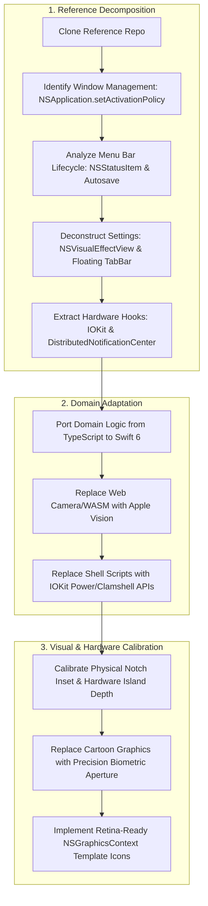
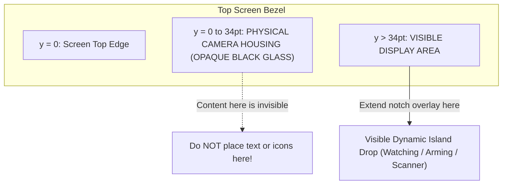

# Native macOS Craft: The Engineering Playbook

This playbook documents the end-to-end process, architectural principles, and engineering patterns used to design, build, and refine **Pupil**—a native macOS menu bar and MacBook notch security sentinel.

It serves as a repeatable reference guide for transforming "vibe-coded" prototypes (Electron, heavy web wrappers, hardcoded DOMs) into high-craft, battery-friendly, platform-native macOS applications that feel built by Apple.

---

## 1. The Core Philosophy: "De-Vibe-Coding"

| Vibe-Coded Prototype | Platform-Native Craft (Apple HIG) |
| :--- | :--- |
| Electron / Chromium runtime (150MB+ idle RAM) | Pure Swift 6 + SwiftUI + AppKit (~18MB idle RAM) |
| Web canvas drawing literal cartoon eyeballs | Precision biometric optical aperture with Apple reticles |
| Poll-based shell scripts (`pmset`, `sudoers` hacks) | Native `IOKit` power & clamshell APIs + `IOPMAssertion` |
| Floating browser window / generic desktop card | Dockless menu bar agent (`.accessory`) + hardware notch overlay |
| Web CSS borders, artificial box-shadows, hex colors | Native `NSVisualEffectView` (`.sidebar` vibrancy), AppKit window masking |
| WebAudio / bundled MP3 siren assets | Real-time `AVAudioEngine` dual-tone square wave synthesis |
| Heavy WASM models in browser thread | Apple `Vision` framework running directly on Apple Neural Engine |

---

## 2. Reverse-Engineering the Reference (Glance Case Study)

When re-architecting an application, start by extracting concrete patterns from the platform's gold standard (e.g., [Glance](https://github.com/jonnyoo/glance)):



---

## 3. The Native Menu Bar Agent Pattern

A common failure in macOS menu bar utilities is disappearing icons, collapsing widths, or accidental Dock pollution.

### A. The Dockless Agent Configuration
In `Info.plist`:
```xml
<key>LSUIElement</key>
<true/>
```
In `AppDelegate.swift`:
```swift
func applicationWillFinishLaunching(_ notification: Notification) {
    NSApp.setActivationPolicy(.accessory)
}
```
*When Settings opens, switch to `.regular` so the window gains focus and Cmd-Tab works; when the last window closes, immediately revert to `.accessory`.*

### B. Bulletproof `NSStatusItem` Setup
1. **Never rely on unmeasured `variableLength` for idle states**: It collapses to 0 width if an SF symbol or image is delayed in rendering.
2. **Use `squareLength` (24×24 pt) by default**, and expand dynamically to `variableLength` only when showing countdown text.
3. **Set `autosaveName`**: The macOS WindowServer persists the icon's position across reboots and display reconnects.
4. **Draw resolution-independent template graphics**:

```swift
let item = NSStatusBar.system.statusItem(withLength: NSStatusItem.squareLength)
item.autosaveName = "com.pupil.security.menubar"

// Guaranteed pixel-perfect vector template rendering
let icon = NSImage(size: NSSize(width: 18, height: 18), flipped: false) { rect in
    guard let ctx = NSGraphicsContext.current?.cgContext else { return false }
    // Draw crisp CoreGraphics paths...
    return true
}
icon.isTemplate = true
item.button?.image = icon
item.button?.imagePosition = .imageLeft
```

---

## 4. Replicating Apple System Settings UI

Native macOS settings windows don't use standard titlebars or flat grey backgrounds.

### A. Window Chrome Configuration
```swift
window.styleMask = [.titled, .closable, .miniaturizable, .fullSizeContentView]
window.titlebarAppearsTransparent = true
window.titleVisibility = .hidden

// Reserving the top traffic light band with the unified toolbar buys macOS's native 26pt corner radius
let toolbar = NSToolbar(identifier: "PupilSettingsToolbar")
window.toolbar = toolbar
window.toolbarStyle = .unified
window.isMovableByWindowBackground = true
```

### B. Adaptive Glass Vibrancy (`NSVisualEffectView`)
Use the system `.sidebar` material with appearance-adaptive color control saturation filters:
* Light Mode saturation boost: `1.75`
* Dark Mode saturation boost: `1.20`

### C. Floating Pill Tab Bar with Trackpad Gestures
* Pinned to bottom with `.regularMaterial` and subtle capsule hairline strokes.
* Tracks tab frames via `PreferenceKey` to slide an animated pill behind the active tab.
* Installs an `NSEvent.addLocalMonitorForEvents(matching: .scrollWheel)` to detect 2-finger horizontal trackpad swipes with velocity thresholds.

---

## 5. Hardware Notch & Dynamic Island Geometry

### The Physical Obstruction Trap
> [!WARNING]
> MacBook screens with a notch / camera island have a physical black plastic housing extending **32–38 pt** down from the top edge. Any content drawn in that top band is physically obscured by the hardware!



### The Solution: The Dynamic Island Drop
1. Query `NSScreen.safeAreaInsets.top` or `auxiliaryTopLeftArea` to calculate `hardwareNotchHeight`.
2. Anchor an `NSPanel` at `CGShieldingWindowLevel() + 1` with collection behavior `[.canJoinAllSpaces, .fullScreenAuxiliary]`.
3. In `NotchOverlayView`, add a transparent top spacer matching `hardwareNotchHeight`.
4. Render all interactive UI (status capsule, countdown, biometric scanner, PIN field) in the extended drop **below the hardware island**.

---

## 6. Sleek Biometric Design vs. "AI-Generated" Tropes

| Avoid (AI / Vibe-Coded Look) | Use (Apple High-Craft Look) |
| :--- | :--- |
| Cartoon eyeball with white sclera ellipse | Precision circular optical bezel with fine metallic rim |
| Blue radial gradient blob iris | Focused cyan / electric-blue optical core with reticle blades |
| White circular reflection highlight dot | Micro-specular catchlight or crisp central pupil aperture |
| Clunky CSS buttons with hard drop shadows | Frosted glass capsules, SF Symbols, hairline stroke borders |
| Generic sans-serif web fonts | SF Pro Rounded / Monospaced with calibrated tracking |
| Jumpy, instant layout changes | Calibrated spring animations (`response: 0.35, damping: 0.78`) |

---

## 7. Native Hardware Sensors & Audio Synthesis

### A. MagSafe / USB-C Charger Detection
Instead of running subprocesses, use `IOKit.ps`:
```swift
guard let blob = IOPSCopyPowerSourcesInfo()?.takeRetainedValue(),
      let powerType = IOPSGetProvidingPowerSourceType(blob)?.takeUnretainedValue() else { return }
let isOnAC = (powerType as String) == (kIOPSACPowerValue as String)
```

### B. Clamshell Lid State
Query `IOPMrootDomain`:
```swift
let service = IOServiceGetMatchingService(kIOMainPortDefault, IOServiceMatching("IOPMrootDomain"))
let prop = IORegistryEntryCreateCFProperty(service, "AppleClamshellState" as CFString, kCFAllocatorDefault, 0)
let isClosed = CFBooleanGetValue((prop as! CFBoolean))
```

### C. Sleep Prevention Assertion
Keep the audio siren and monitoring alive during lid closures:
```swift
var assertionID: IOPMAssertionID = 0
IOPMAssertionCreateWithName(
    kIOPMAssertionTypePreventUserIdleSystemSleep as CFString,
    IOPMAssertionLevel(kIOPMAssertionLevelOn),
    "Pupil Active Siren" as CFString,
    &assertionID
)
```

### D. Zero-Asset Audio Siren (`AVAudioEngine`)
Generate alternating two-tone audio (880 Hz / 660 Hz) directly through an `AVAudioSourceNode` into the system audio bus—eliminating external MP3 files and bundle asset dependencies.

---

## 8. On-Device Vision & Privacy

1. **AVFoundation 10 FPS Throttle**: Capture frames at 640×480 and throttle to ~10 FPS to keep CPU utilization under 3% and preserve battery.
2. **Apple Vision Landmark Pipeline**:
   - `VNDetectFaceRectanglesRequest` finds face centroids.
   - `VNDetectFaceLandmarksRequest` reads `leftPupil`, `rightPupil`, `leftEye`, `rightEye`, `yaw`, and `pitch`.
3. **Toward-Screen Composite Metric**:
   $$Score = 1.0 - (0.48 \times YawPenalty + 0.24 \times PitchPenalty + 0.28 \times IrisPenalty)$$
4. **Temporal Dwell Aggregation**:
   - Accumulate continuous dwell time towards user-defined thresholds (e.g. 2.0s).
   - Tolerate physiological blinks ($\le 350\text{ms}$) without resetting the accumulator.
   - Strictly discard camera frames in memory immediately after analysis.

---

## 9. Security & Authentication Architecture

1. **Zero Plaintext Storage**: Never write or log raw PINs.
2. **Cryptographic Salt + SHA-256**: Disarm PINs are salted with 16 random bytes from `SecRandomCopyBytes` and hashed via `CryptoKit.SHA256`.
3. **Keychain Services Integration**: Hashes are stored with `kSecClassGenericPassword` under service `com.pupil.security`.
4. **Biometric Disarm**: Seamlessly gate disarm actions with `LAContext.evaluatePolicy(.deviceOwnerAuthenticationWithBiometrics)`.

---

## 10. One-Time Phone Companion & Direct W3C Web Push (RFC 8291 + VAPID)

Local WebSockets (`ws://127.0.0.1:8787`) fail in production because iOS and Android suspend background browser tabs within ~30 seconds of locking the phone screen, and public library/cafe Wi-Fi networks enforce AP Client Isolation.

Instead, Pupil implements **native end-to-end encrypted W3C Web Push (`RFC 8030` + `RFC 8291` + `RFC 8292`)** directly from macOS `CryptoKit` to Apple's `https://web.push.apple.com` APNs servers:

1. **In-App CoreImage QR Code**: `WebPushManager` generates a persistent P-256 VAPID signing identity (`P256.Signing.PrivateKey`) and renders a razor-sharp QR code (`CIQRCodeGenerator`) inside `SensorsSettingsPage`.
2. **Single-Scan Home Screen PWA (`docs/index.html`, `docs/manifest.json`, `docs/sw.js`)**:
   - Hosted statically on GitHub Pages (`https://stevewong-a.github.io/pupil/`).
   - Omitting `start_url` in `manifest.json` and caching the `?v=<vapidPubKey>&c=<channel>` parameters in `CacheStorage` ensures the user only scans the QR code **once** in Safari before tapping **Add to Home Screen**.
3. **Automatic One-Time Handshake + Universal Clipboard Fallback**:
   - Tapping **Pair & Enable Lock-Screen Alerts** in the Home Screen app subscribes via `pushManager.subscribe({ userVisibleOnly: true, applicationServerKey })` and automatically transmits the `pupilpair://` token back to the Mac (with 1-tap Apple Universal Clipboard fallback).
4. **Zero-Server Direct APNs Delivery**:
   - On Armed Input Lock, Tamper Countdown, or Siren Alarm, `WebPushManager` signs an `ES256` VAPID JWT and encrypts the alert payload with ephemeral P-256 ECDH + `HKDF<SHA256>` + `AES-128-GCM` (`aes128gcm`), sending an HTTPS `POST` directly from the Mac to `web.push.apple.com` to wake the locked iPhone across any Wi-Fi or 5G network.

---

## 11. Packaging & Verification Checklist

Before releasing any native macOS utility:
- [x] Compile cleanly under modern Swift (`swift build`) with zero warnings.
- [x] Package into a valid macOS app bundle structure (`Pupil.app/Contents/MacOS/Pupil` + `Info.plist`).
- [x] Validate ad-hoc codesigning (`codesign --force --deep --sign - Pupil.app`).
- [x] Verify Dockless behavior: App icon does not appear in Dock on launch (`.accessory`).
- [x] Verify Menu Bar persistence: Icon appears in `NSStatusBar.system` and does not collapse or disappear when other apps take focus.
- [x] Verify Camera Island clearance: All notch overlay elements render visibly below the physical camera cutout.
- [x] Verify Sleep/Wake assertions: Lid closure latches audio before the system enters deep suspend.
- [x] Run deterministic unit test suite covering Keychain auth, state transitions, and gaze dwell accumulators.
