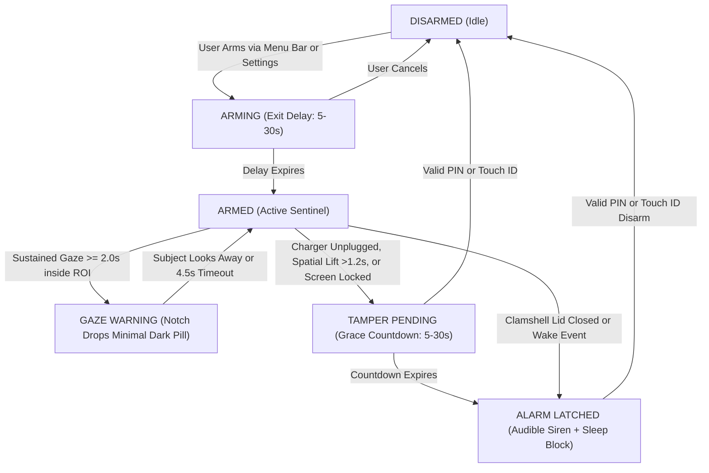
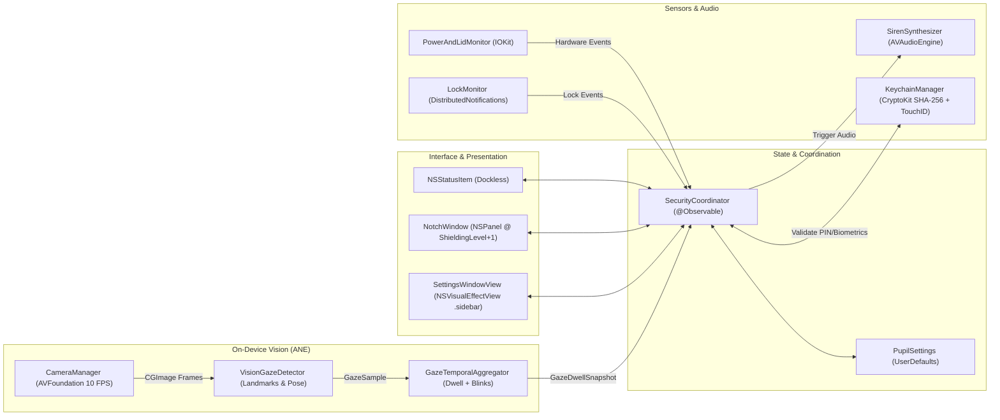

# Pupil: Comprehensive Codebase Knowledge Base & Agent Index

This document serves as the persistent architectural reference, symbol catalog, and semantic knowledge base for the **Pupil** codebase. It is designed to allow AI agents and human engineers to navigate, understand, and modify the application with zero ambiguity.

---

## 1. Executive Summary

* **Project Name**: Pupil
* **Platform**: macOS 15.0+ (Sequoia), Apple Silicon & Intel
* **Tech Stack**: Swift 6, AppKit, SwiftUI, Apple Vision, AVFoundation, IOKit, CryptoKit, LocalAuthentication, Security
* **Purpose**: A platform-native macOS security sentinel designed for students and solo workers in libraries, cafes, or co-working spaces.
* **Core Value Proposition**: Replaces heavy web wrappers (Electron/Chromium) and fragile shell script hacks (`pmset`, `sudoers`) with a 100% platform-native, battery-friendly (~18MB RAM) menu bar agent and hardware notch overlay.

---

## 2. Four-Tier Escalation Model



| Tier | Name | Triggers | Native System Response |
| :--- | :--- | :--- | :--- |
| **Tier 1** | **Armed Deterrence** | User arms via `⌘A`, Menu Bar, or Settings header | Menu bar glyph switches to template aperture; IOKit hardware power polling, clamshell monitor, and Vision spatial lift anchor arm. |
| **Tier 2** | **Gaze Warning** | Face detected in camera ROI with sustained gaze toward screen ($\ge 0.5\text{–}3.0\text{s}$) | Hardware notch drops dark pill status indicator; optional instant Screen Privacy Blur obscures display content while gaze lingers. |
| **Tier 3** | **Tamper Countdown** | MagSafe/USB-C charger unplugged (`IOPSCopyPowerSourcesInfo`), sustained spatial lift/occlusion ($> 1.2\text{s}$), or screen locked | Notch expands with amber countdown pill; enables keyboard focus for inline PIN or Touch ID biometric disarm. |
| **Tier 4** | **PIN-Latched Siren** | Clamshell lid closed (`AppleClamshellState`), system wake while armed, or countdown expiry | Acquires `IOPMAssertion` to prevent sleep; `AVAudioEngine` synthesizes alternating 880Hz/660Hz square waves until valid PIN or Touch ID disarm. |

---

## 3. Subsystem Architecture



---

## 4. Key Subsystems & Invariants

### 4.1. App Lifecycle & Menu Bar (`PupilApp.swift`, `MenuBarIconFactory.swift`)
* **Dockless Accessory Mode**: `NSApp.setActivationPolicy(.accessory)` keeps the app out of the Dock and Cmd-Tab switcher.
* **Settings Chrome Switch**: Transitions to `.regular` policy when the Settings window is open so it can take focus, then cleanly reverts to `.accessory` when closed.
* **Quit Interception**: In `applicationShouldTerminate`, if `coordinator.isMonitoring` is true, the app rejects termination (`.terminateCancel`), beeps, and surfaces Settings for PIN disarm.
* **Menu Bar Vector Graphics**: `MenuBarIconFactory.makeStatusIcon` renders resolution-independent template `NSImage` paths using CoreGraphics.

### 4.2. State Machine & Event Hub (`SecurityCoordinator.swift`)
* Central `@Observable @MainActor` state machine.
* Manages state transitions: `disarmed` $\rightarrow$ `arming` $\rightarrow$ `armed` $\rightarrow$ `tamperPending` $\rightarrow$ `alarm`.
* Maintains in-memory session audit trail (`SecurityEventRecord`, ring-buffered to 100 entries).

### 4.3. Native Hardware Monitors (`PowerAndLidMonitor.swift`, `LockMonitor.swift`)
* **Charger Detection**: `IOPSCopyPowerSourcesInfo` queried on a 150ms timer.
* **Clamshell Lid**: Reads `AppleClamshellState` from `IOServiceMatching("IOPMrootDomain")`.
* **Sleep Hold Assertion**: Calls `IOPMAssertionCreateWithName` with `kIOPMAssertionTypePreventUserIdleSystemSleep` to ensure the audio engine can alert before macOS cuts power.
* **Lock Monitoring**: Listens to `DistributedNotificationCenter.default()` for `"com.apple.screenIsLocked"` and `NSWorkspace` sleep/wake notifications.

### 4.4. Audio Siren Synthesis (`SirenSynthesizer.swift`)
* **Zero Bundled Audio Assets**: No MP3/WAV file dependencies.
* **Real-time Synthesis**: Runs an `AVAudioEngine` with an `AVAudioSourceNode` generating an alternating square wave:
  $$f_{\text{high}} = \text{baseFrequencyHz (e.g. 880 Hz)}, \quad f_{\text{low}} = 0.75 \times f_{\text{high}} \text{ (660 Hz)}$$
  Switching period: 0.45s per half-cycle.

### 4.5. Cryptographic Storage & Biometrics (`KeychainManager.swift`)
* **Zero Plaintext PIN Storage**: Never logs or persists cleartext PINs.
* **Salted SHA-256**: Generates 16 random bytes via `SecRandomCopyBytes`, computes:
  $$\text{Digest} = \text{SHA256}(\text{saltHex} + \text{":"} + \text{pin})$$
* **Isolated Application Vault**: Stored in user-scoped `UserDefaults` and local application vault (`~/Library/Application Support/Pupil/pin.record` with `0600` permissions), avoiding legacy `login.keychain-db` system password prompts.
* **Timing-Safe Equality**: Constant-time byte-by-byte XOR comparison (`diff |= a[i] ^ b[i]`) prevents timing attacks.
* **Touch ID**: Delegated to `LAContext.evaluatePolicy(.deviceOwnerAuthenticationWithBiometrics)`.

### 4.6. On-Device Vision Pipeline (`CameraManager.swift`, `VisionGazeDetector.swift`)
* **Privacy By Design**: 100% on-device processing via Apple Neural Engine; frames are never written to disk or transmitted over the network.
* **10 FPS Throttle**: Throttled to $\ge 0.10\text{s}$ per frame at 640×480 resolution to maintain $<3\%$ CPU usage.
* **Gaze Metric**:
  $$\text{Score} = 1.0 - (0.48 \times \text{YawPenalty} + 0.24 \times \text{PitchPenalty} + 0.28 \times \text{IrisPenalty})$$
* **Blink Tolerance**: Physiological blinks $\le 350\text{ms}$ do not reset continuous dwell accumulation.
* **Centroid Shift Reset**: L2 distance movement $> 0.18$ normalized screen distance resets tracking to prevent false triggers when people walk past.

### 4.7. Hardware Notch Overlay (`NotchGeometry.swift`, `NotchShape.swift`, `NotchWindow.swift`, `NotchOverlayView.swift`, `NotchOverlayController.swift`)
* **Shielding Window Level**: Uses `NSPanel` at `CGShieldingWindowLevel() + 1` with `collectionBehavior = [.canJoinAllSpaces, .stationary, .fullScreenAuxiliary, .ignoresCycle]`.
* **Hardware Clearance Inset**: Adds a transparent spacer equal to `hardwareNotchHeight` (32–38pt) so all interactive text and biometric reticles render visibly below the physical camera glass.
* **Dynamic Island Fallback**: When running on notchless external displays, dynamically transitions to a continuous-corner pill.

### 4.8. Full-Screen Privacy Blur Shield (`ScreenShieldWindow.swift`, `ScreenShieldView.swift`, `ScreenShieldController.swift`)
* **Dynamic Blur Policy**: By default, arming the laptop sentinel does NOT blur the display—the desktop remains completely unblurred until an unauthorized gaze is detected (`blurScreenOnGaze`), any key or mouse click is pressed while armed, or until a hardware tamper/alarm occurs. Users can optionally enable full-time blur while armed via "Blur screen while armed" (`blurBackgroundWhenArmed`).
* **Armed User Input Challenge**: An active global and local `NSEvent` input monitor listens while armed. The moment an unauthorized person (or user) touches any keyboard key or clicks the mouse/trackpad anywhere on the screen, the display immediately locks with the frosted privacy shield and challenges for Keychain PIN or Touch ID disarm (`isInteractiveUnlockRequested`).
* **Deep Frosted Obsidian Scrim**: Renders a 95% opacity obsidian privacy base (`Color(red: 0.06, green: 0.07, blue: 0.09).opacity(0.95)`), `NSVisualEffectView` with `.fullScreenUI` material (`.withinWindow` vibrancy), and an obsidian radial vignette. Completely obscures all background windows, text, and confidential documents across all displays.
* **Multi-Display Coverage**: Dynamically creates and updates full-screen shielding windows for every screen in `NSScreen.screens` on display connect/disconnect. The primary display hosts the interactive unlock dialog; secondary displays provide privacy blur and route focus to the primary dialog on click.
* **Reliable Input & Focus Resilience**: The unlock card is presented front-and-center with immediate AppKit keyboard focus, automatic Touch ID prompt (when enabled), and an in-field clickable Delete (`delete.backward.fill`) button. Background clicks refocus the input field instead of vanishing into an unclickable limbo. The window intercepts Backspace/Delete (key codes 51/117), Return/Enter (36/76), and numeric keystrokes to ensure text editing and deletion always succeed.
* **Screen Content Privacy Blur on Gaze**: When `blurScreenOnGaze` is enabled (default `true`), any sustained unauthorized gaze detected by the Vision iris estimator instantly covers all displays with the deep frosted-glass privacy blur and a centered privacy capsule ("Privacy Shield Active"). If the subject looks away without touching anything, the screen cleanly unblurs. If any key or mouse click is pressed, it immediately switches into the PIN / Touch ID authentication challenge.
* **Notch Pass-Through Hit-Testing**: `NotchWindow` and `NotchHostingView` dynamically restrict hit-testing to the visible notch silhouette `activeNotchSize`. Clicks outside the notch bounds return `nil`, passing straight through to web pages, browser tabs, and desktop applications below.
* **Zero Bypass Policy**: While in full-time armed lock, input challenge, or tamper alarm, the screen cannot be dismissed, bypassed, or unblurred until valid Keychain PIN or Touch ID verification transitions `SecurityCoordinator.state` back to `.disarmed`. During exit-delay arming or preview, pressing Escape or clicking Cancel dismisses the shield cleanly.

### 4.9. Settings Design System (`SettingsControls.swift`, `SettingsMetrics.swift`, `SettingsTabBar.swift`, `ProgressiveHeaderBlur.swift`)
* **Native Vibrancy**: `NSVisualEffectView` with `.sidebar` material and appearance-adaptive CIColorControls saturation filter (1.75 in light mode, 1.20 in dark mode).
* **Unified Toolbar**: Uses `NSToolbar` with `.unified` style and transparent background to acquire macOS's native 26pt corner radius.
* **Floating Capsule Tab Bar**: Bottom-pinned pill with dynamic sliding indicator and unfurling label animation.
* **Trackpad Gestures**: `NSEvent.addLocalMonitorForEvents(matching: .scrollWheel)` for horizontal two-finger tab swiping.

---

## 5. File & Symbol Cross-Reference Index

| File Path | Role | Key Symbols |
| :--- | :--- | :--- |
| `Sources/Pupil/PupilApp.swift` | App Entry Point & Menu Bar Lifecycle | `PupilApp`, `AppDelegate` |
| `Sources/Pupil/Core/SecurityCoordinator.swift` | Central State Machine & Dispatcher | `SecurityCoordinator`, `SecurityState`, `TamperSource`, `SecurityEventRecord` |
| `Sources/Pupil/Core/PowerAndLidMonitor.swift` | IOKit AC Power & Clamshell Monitor | `PowerAndLidMonitor`, `PowerHardwareEvent` |
| `Sources/Pupil/Core/LockMonitor.swift` | Screen Lock & Sleep Monitor | `LockMonitor`, `LockEventKind` |
| `Sources/Pupil/Core/SirenSynthesizer.swift` | Real-time Two-Tone Alarm Synthesizer | `SirenSynthesizer` |
| `Sources/Pupil/Core/KeychainManager.swift` | Salted SHA-256 PIN & Touch ID Store | `KeychainManager`, `KeychainError` |
| `Sources/Pupil/Vision/VisionGazeDetector.swift` | Apple Vision Landmark & Dwell Detector | `VisionGazeDetector`, `GazeSample`, `GazeDwellSnapshot`, `GazeTemporalAggregator` |
| `Sources/Pupil/Vision/VisionMotionDetector.swift` | Apple Vision Spatial Lift & Motion Detector | `VisionMotionDetector`, `MotionSample`, `MotionEscalationSnapshot`, `MotionTemporalAggregator` |
| `Sources/Pupil/Vision/CameraManager.swift` | AVFoundation 10 FPS Frame Ingestion | `CameraManager`, `CameraDeviceInfo` |
| `Sources/Pupil/NotchOverlay/NotchGeometry.swift` | Hardware Notch & Pill Dimensions | `NotchGeometry`, `NotchPanelStyle` |
| `Sources/Pupil/NotchOverlay/NotchShape.swift` | Concave Corner Notch Silhouette Path | `NotchShape` |
| `Sources/Pupil/NotchOverlay/NotchWindow.swift` | Non-activating Top-Level NSPanel | `NotchWindow` |
| `Sources/Pupil/NotchOverlay/NotchOverlayView.swift` | Biometric Eye & Inline Disarm UI | `NotchOverlayView`, `PupilEyeVectorView` |
| `Sources/Pupil/NotchOverlay/NotchOverlayController.swift` | Window Positioning & Screen Tracking | `NotchOverlayController` |
| `Sources/Pupil/ScreenShield/ScreenShieldWindow.swift` | Full-Screen Shielding NSPanel | `ScreenShieldWindow` |
| `Sources/Pupil/ScreenShield/ScreenShieldView.swift` | Full-Screen Frosted Glass Blur & Unlock Card | `ScreenShieldView` |
| `Sources/Pupil/ScreenShield/ScreenShieldController.swift` | Multi-Display Privacy Blur Manager | `ScreenShieldController` |
| `Sources/Pupil/MenuBar/MenuBarIconFactory.swift` | Vector CoreGraphics Template Icons | `MenuBarIconFactory` |
| `Sources/Pupil/Settings/PupilSettings.swift` | Reactive Observable Settings Store | `PupilSettings`, `GazeSensitivity`, `NotchDeterrentStyle`, `HardwareTrigger`, `CameraROI` |
| `Sources/Pupil/Settings/SettingsMetrics.swift` | Design Tokens, Spacing & Color Filters | `SettingsMetrics`, `PupilTheme` |
| `Sources/Pupil/Settings/SettingsControls.swift` | System Settings UI Components | `VisualEffectView`, `WindowConfigurator`, `SettingsRow`, `SettingsGroup`, `PupilToggle` |
| `Sources/Pupil/Settings/SettingsTab.swift` | Tab Categories | `SettingsTab`, `SettingsTabIcon` |
| `Sources/Pupil/Settings/SettingsTabBar.swift` | Floating Pill Tab Bar View | `SettingsTabBar` |
| `Sources/Pupil/Settings/ProgressiveHeaderBlur.swift` | Progressive Material Header Blur | `ProgressiveHeaderBlur` |
| `Sources/Pupil/Settings/HeaderStatusButton.swift` | Header State Capsule & Disarm Popover | `HeaderStatusButton` |
| `Sources/Pupil/Settings/SettingsWindowView.swift` | Root Settings Scene & Trackpad Swiping | `SettingsWindowView` |
| `Sources/Pupil/Settings/Pages/GeneralSettingsPage.swift` | General Preferences & Timing Sliders | `GeneralSettingsPage` |
| `Sources/Pupil/Settings/Pages/GazeSettingsPage.swift` | Vision Sensitivity & Live Telemetry | `GazeSettingsPage` |
| `Sources/Pupil/Settings/Pages/SensorsSettingsPage.swift` | Hardware Readouts & Relay Configuration | `SensorsSettingsPage` |
| `Sources/Pupil/Settings/Pages/AlarmSettingsPage.swift` | Siren Pitch & Session Event Audit Log | `AlarmSettingsPage` |
| `Sources/Pupil/Settings/Pages/AboutSettingsPage.swift` | Version Info & Privacy Specifications | `AboutSettingsPage` |
| `Tests/PupilTests/PupilSecurityTests.swift` | Unit Tests for Keychain, Dwell, State | `PupilSecurityTests` |
| `scripts/bundle-app.sh` | App Bundle Packaging Script | `bundle-app.sh` |
| `scripts/build-dmg.sh` | Drag-and-Drop DMG Installer & ZIP Packager | `build-dmg.sh` |
| `scripts/generate-icon.swift` | Multi-resolution Retina AppIcon.icns Generator | `generate-icon.swift` |
| `scripts/generate_embeddings.py` | Embeddings & Metadata Generator | `generate_embeddings.py` |

---

## 6. Build, Verification & Testing Commands

```bash
# 1. Run unit test suite
swift test

# 2. Package single downloadable installer (Pupil.dmg & Pupil.zip)
./scripts/build-dmg.sh

# 3. Mount and verify the installer disk image
hdiutil attach dist/Pupil.dmg

# 4. Launch with Settings window immediately visible
./dist/Pupil.app/Contents/MacOS/Pupil --open-settings

# 5. Regenerate semantic embeddings index
python3 scripts/generate_embeddings.py
```
